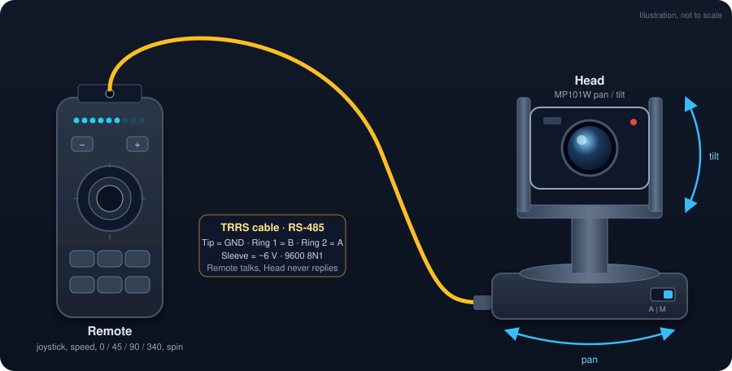
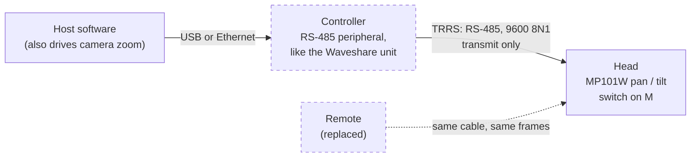
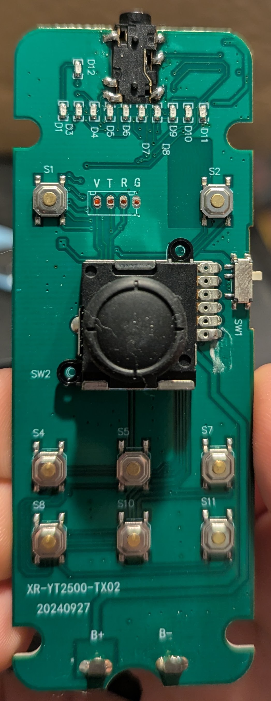

<div align="center">

# Bescor MP101W wired control

**Reverse engineering the wired link of a pan/tilt head, so software can replace the handheld remote.**



[**Read the spec**](docs/spec.md) &nbsp;&middot;&nbsp; [Glossary](CONTEXT.md) &nbsp;&middot;&nbsp; [Captures](captures/) &nbsp;&middot;&nbsp; [Pelco-D comparison](docs/spec.md#appendix-a-pelco-d-divergence)

</div>

---

## Why this exists

The Bescor MP101W is a motorised pan/tilt head. Its wired Remote plugs into the Head through a 3.5 mm TRRS jack, and Bescor has published nothing about what travels over that cable. Customers want to drive the Head from software (alongside camera zoom) over USB or Ethernet, which needs a **Controller** that speaks the Remote's language.

This repository works out that language and writes it down. The result is **[docs/spec.md](docs/spec.md)**.

> [!NOTE]
> The spec is reverse-engineered, not a vendor document. Every behavioural claim in it is tagged `[wire]`, `[observed]` or `[untested]`, so you can see what is solid and what was only watched by eye.

## The link at a glance

| | |
|---|---|
| **Physical layer** | RS-485 on the TRRS jack: Ring 2 = A, Ring 1 = B, Tip = ground, Sleeve = about 6 V from the Head |
| **Serial settings** | 9600 baud, 8 data bits, no parity, 1 stop bit |
| **Frame** | 7 bytes: `ff 01 cmd1 cmd2 data1 data2 chk` |
| **Checksum** | (address + cmd1 + cmd2 + data1 + data2) mod 256 |
| **Direction** | Remote to Head only; the Head never replies |
| **Timing** | One frame about every 50 ms while a control is held, then 20 stop frames |
| **Looks like** | Pelco-D framing, but the commands are not Pelco-D |



## Anatomy of a frame

```
ff   01   00   04   4f   00   54
│    │    │    │    │    │    └─ checksum  01 + 00 + 04 + 4f + 00 = 0x54
│    │    │    │    │    └────── data2     tilt speed (0 when not tilting)
│    │    │    │    └─────────── data1     pan speed (speed level 4f)
│    │    │    └──────────────── cmd2      direction bits: Right = 04
│    │    └───────────────────── cmd1      00 for jogs
│    └────────────────────────── address   always 01
└─────────────────────────────── sync
```

## Command cheat sheet

`<lvl>` is one of the Remote's ten speed levels, `17` to `5f` in steps of 8. Full tables, checksums and evidence tags are in the [spec](docs/spec.md#4-commands).

| Action | Frame |
|---|---|
| Jog Up / Down | `ff 01 00 10 00 <lvl> chk` / `ff 01 00 08 00 <lvl> chk` |
| Jog Left / Right | `ff 01 00 02 <lvl> 00 chk` / `ff 01 00 04 <lvl> 00 chk` |
| Diagonals | `ff 01 00 <12 \| 14 \| 0a \| 0c> <lvl> <lvl> chk` |
| Stop | `ff 01 00 00 00 00 01` |
| Go to 0 degrees | `ff 01 08 03 00 00 0c` |
| Sweep 45 / 90 / 340 degrees | `ff 01 08 03 00 2d 39` / `ff 01 08 03 00 5a 66` / `ff 01 08 03 01 54 61` |
| Spin Left / Right | `ff 01 08 03 01 69 76` / `ff 01 08 03 01 6a 77` |

## What the Head will and won't do

- **Has its own dead-man.** It stops by itself about a second after frames cease, and one stop frame is enough.
- **Sweeps and Spin are ended by the zero frame or a jog**, not by stop frames.
- **No go-to-angle.** `08 03 <deg>` honours only 0, 45, 90, 340 and Spin; arbitrary angles are ignored.
- **Only answers address `01`**, and never transmits, so a Controller needs no receive path.

> [!WARNING]
> On a first connection of a different Controller design, limit current with a series resistor per signal line and keep a hand on the Head's power. The [drive-circuit guidance](docs/spec.md#7-drive-circuit-guidance) describes the one configuration proven to work.

## Evidence

The protocol was recovered from a Remote PCB teardown, scope Captures of Ring 1 / Ring 2, a Tap log of the Remote's transmitter, a wire-versus-tap cross-check, and a probe of the Head from a real Controller.

<table>
<tr>
<td width="220"></td>
<td>

**The Remote's PCB** (XR-YT2500-TX02). A BL3085 RS-485 transceiver drives the jack and its receive pin is unconnected, so the Remote only transmits. The Tap log was taken from the transceiver's driver input.

[Back of the board](docs/teardown/remote-pcb-back.jpg) &middot; [Evidence map](docs/spec.md#appendix-b-evidence)

</td>
</tr>
</table>

## Repository map

| Path | What it holds |
|---|---|
| [docs/spec.md](docs/spec.md) | The authoritative specification |
| [CONTEXT.md](CONTEXT.md) | Glossary: Head, Remote, Controller, Host, Tip, Ring 1, Ring 2, Sleeve, Capture, Tap log, Wire log, Frame |
| [captures/](captures/) | Raw Labrador Captures, Tap logs, Wire logs and probe records, each directory with a manifest |
| [tools/](tools/) | Python scripts that demonstrate the protocol (send, probe, record, analyse); not a supported library |
| [docs/research/](docs/research/go-to-angle-candidates.md) | Background research on Pelco-D and go-to-angle candidates |
| [docs/findings.md](docs/findings.md) | Starting evidence, superseded by the spec |
| Planning | The GitHub issue labelled `wayfinder:map` |

## Status

- [x] Electrical layer characterised
- [x] Framing and full Remote command set decoded
- [x] Head probed for tolerances, replies and extra commands
- [x] Specification written
- [ ] Building the Controller (a separate effort, out of scope here)
